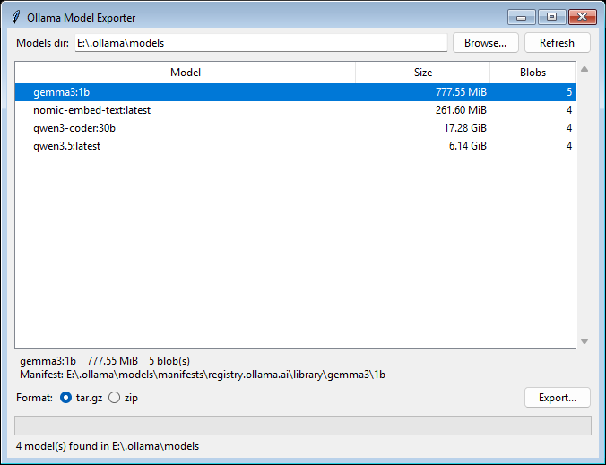

# Ollama Model Extractor

Export Ollama models from one machine and import them on another — no re-download, no `ollama pull`. The tool reads a model's manifest, finds the exact blob files it references, and packs them into a single compressed archive (`.tar.gz` or `.zip`) that unpacks straight into the Ollama models directory on the target machine.



## Features

- **Automatic blob resolution** — no more manually matching manifest digests to blob files
- **Two interfaces** — an interactive command-line tool and a Tkinter GUI
- **Portable archives** — the archive mirrors Ollama's storage layout (`manifests/` + `blobs/`), so importing is just extracting it
- **Cross-platform** — Windows and Linux (macOS works too)
- **Zero dependencies** — Python standard library only, no `pip install`
- **Safe** — verifies referenced blobs exist before starting, checks free disk space, refuses to produce a broken archive
- Import instructions are embedded in every archive (`IMPORT-README.txt`)

## Requirements

- Python 3.9+
- For the GUI: Tkinter — bundled with Python on Windows and macOS; on Debian/Ubuntu install it with `sudo apt install python3-tk`

## Installation

There is nothing to install. Copy the two Python files to any machine, or clone this repo:

```bash
git clone https://github.com/<your-username>/ollama_model_extractor.git
cd ollama_model_extractor
```

The store is auto-detected from the `OLLAMA_MODELS` environment variable or the default `~/.ollama/models` (Windows: `%USERPROFILE%\.ollama\models`). You can also point either tool at a custom location (e.g. a store moved to another drive) — both the models directory and the Ollama root one level above it are accepted.

## Usage — GUI

```bash
python3 ollama_export_gui.py            # Linux
python ollama_export_gui.py             # Windows
pythonw ollama_export_gui.py            # Windows, no console window
```

Optionally pass a store location: `python ollama_export_gui.py --models-dir E:\.ollama`

1. Pick a model from the list (shows size and blob count)
2. Choose the format (tar.gz or zip)
3. Click **Export...**, choose the destination
4. Watch the progress bar; on completion, copy or view the import instructions for the target machine

## Usage — CLI

Interactive mode walks you through: pick a model → confirm destination and format → export with a progress bar.

```bash
python ollama_export.py
```

Scriptable flags:

```bash
python ollama_export.py --list                                # list installed models
python ollama_export.py -m llama3.2 -y                        # export without prompting
python ollama_export.py -m qwen3-coder:30b -o /mnt/usb --format zip
python ollama_export.py --models-dir E:\.ollama               # custom store location
```

| Flag | Meaning |
|---|---|
| `-m`, `--model` | Model to export, e.g. `llama3.2:latest` (skips the picker) |
| `-o`, `--output` | Output archive path (default `./ollama_<model>.tar.gz`) |
| `--format` | `tar` or `zip` |
| `--models-dir` | Ollama models directory (default: `OLLAMA_MODELS` or `~/.ollama/models`) |
| `-y`, `--yes` | Skip confirmation prompts |
| `--list` | List installed models and exit |

## Importing on the target machine

Copy the archive over, then extract it into the Ollama models directory (every archive also contains `IMPORT-README.txt` with these steps):

```bash
# Linux / macOS
tar -xzf ollama_gemma3_1b.tar.gz -C ~/.ollama/models

# Windows (tar ships with Windows 10+)
tar -xzf ollama_gemma3_1b.tar.gz -C %USERPROFILE%\.ollama\models

# zip archives
unzip ollama_gemma3_1b.zip -d ~/.ollama/models
```

If the target machine sets `OLLAMA_MODELS`, extract into that directory instead. Then verify:

```bash
ollama list                              # the model should appear
ollama run gemma3:1b
```

## How it works

Ollama stores each model as a JSON manifest under `manifests/<registry>/<namespace>/<model>/<tag>` plus content-addressed files under `blobs/`. Each manifest lists a config digest and layer digests (`sha256:...`), and the corresponding blob file is named `sha256-<hash>`. The extractor parses the manifest, resolves every digest to its blob, and archives the set while preserving Ollama's directory layout — so unpacking the archive into a models directory reproduces exactly what `ollama pull` would have created.

## Notes

- Packing a large model takes time proportional to its size (e.g. a 17 GiB model means reading and compressing 17 GiB); the progress bar shows bytes packed so you know it's working
- Archives are gzip-compressed but models are mostly already-compressed weights, so expect modest size reductions
- Both tools are read-only with respect to your Ollama store — the originals are never modified

## License

[MIT](LICENSE)
